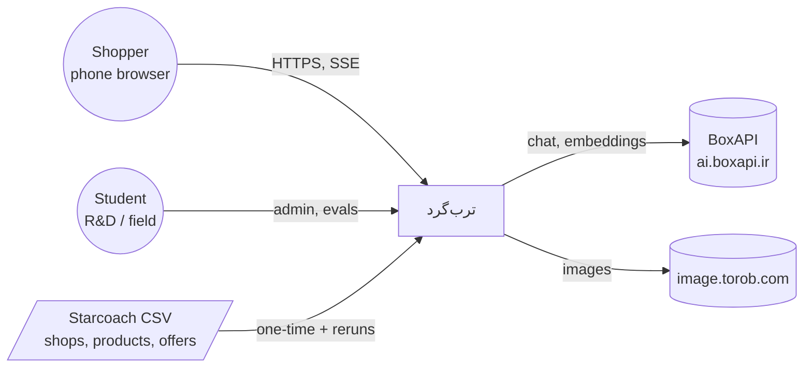
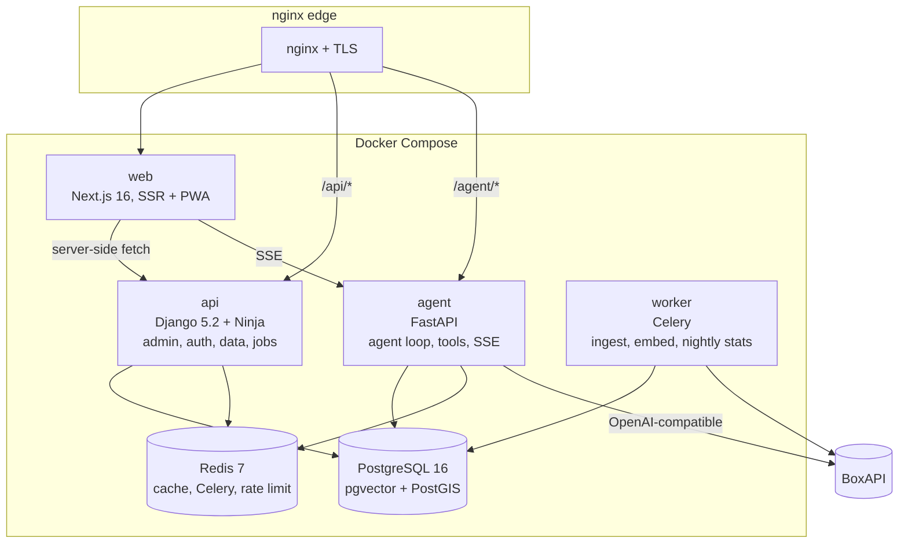
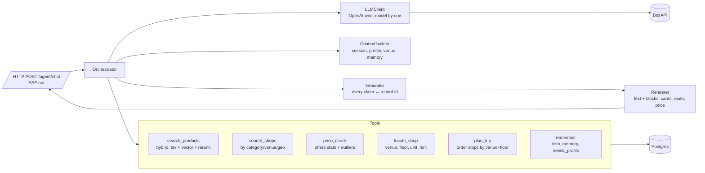
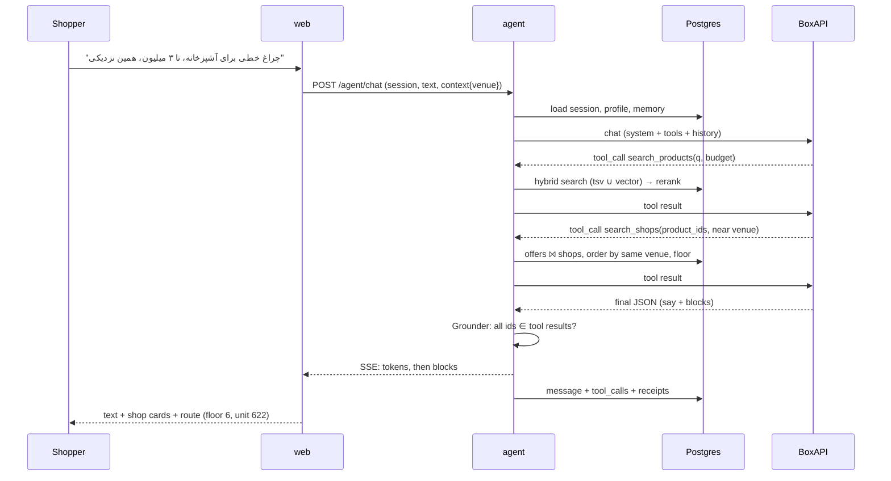
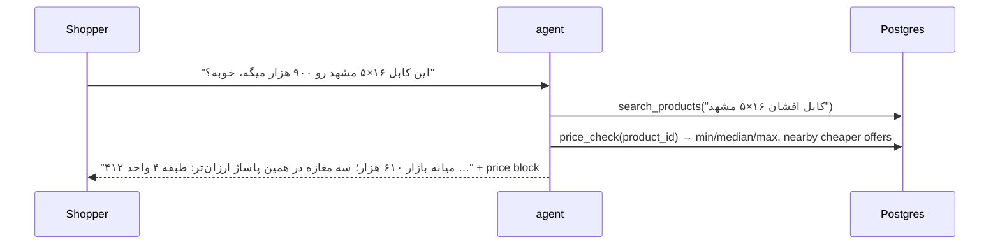
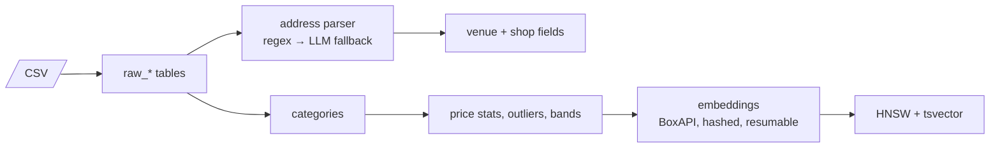
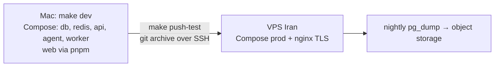

# Software architecture

C4 style: context → containers → components → code conventions. Deployment and ADRs at the end.
Diagrams are mermaid; the published artifact renders them.

## 1. Context



Non-functional targets (demo scale): p95 first token < 2.5 s, full answer < 12 s, 50 concurrent
sessions on one 4-vCPU VPS, every factual claim carries record ids, zero runtime loads from outside
Iran except BoxAPI and Torob images.

## 2. Containers



| Container | Owns | Does not |
|---|---|---|
| **web** | Pages, chat UI, cards, route view, PWA shell, design tokens | No business logic, no direct DB |
| **api** | Schema + migrations, admin (Unfold, RTL), phone OTP auth, REST for catalog/trips/memory, Celery tasks | No LLM calls in request path |
| **agent** | The loop: plan → tools → grounded answer; tool implementations; streaming; receipts | No migrations; writes only `conversation.*` |
| **worker** | CSV ingest, address parsing, embeddings, nightly price stats, outlier flags | |
| **db / redis** | State; Redis holds session cache, tool-result cache (TTL 10 min), rate limits | |

Why `agent` is separate from `api`: async + streaming + model swapping without touching the
Django request cycle; it can scale to 2–3 replicas alone. Both share the Postgres schema; the
agent reads with SQLAlchemy Core and never defines tables.

## 3. Components — agent



**Grounding rule** (hard): the model may only state a shop, price, floor or unit that appears in a
tool result of the same turn. The Grounder checks every id in the structured blocks against the
tool results; a missing id fails the turn and the orchestrator retries once with the violation in
context, then falls back to "I couldn't verify that". `message.receipt_ids` stores what was used.

**Output contract** (what the model must emit, validated with pydantic):

```json
{ "say": "…Persian text…",
  "blocks": [
    {"type":"shop_cards","shop_ids":["shop_3f93…"],"why":{"shop_3f93…":"…"}},
    {"type":"route","venue_id":"…","stops":[{"shop_id":"…","floor":"6","unit":"622"}]},
    {"type":"price_check","product_id":"…","min":…,"median":…,"max":…,"offer_ids":[…]},
    {"type":"ask","question":"…","options":["…","…"]}
  ],
  "profile_updates": {"budget_max": 15000000} }
```

Tool calling: if BoxAPI's `/chat/completions` supports OpenAI `tools`, use it (P0 check, task T-01).
If not, fall back to a JSON "action" turn the orchestrator parses. The orchestrator is written
against an internal `ToolCall` type so both paths look the same.

## 4. Components — web

```
src/app/            routes: / (ask), /chat/[id], /venue/[slug], /shop/[id], /product/[id], /trip/[id], /me
src/components/     chat/ (Composer, Stream, Blocks), cards/ (ShopCard, ProductCard, PriceBar), route/ (FloorList, UnitBadge), interview/ (ImageCards, Budget)
src/lib/            api.ts (typed client), sse.ts, persian.ts (digits, normalize), tokens (Tailwind @theme)
public/fonts/       IRANYekan / Vazirmatn self-hosted
```

Rendering: shop/product/venue pages are SSR + cached (SEO); chat is client-side with SSE. Blocks
from the agent map 1:1 to components; unknown block types render as plain text (forward compatible).

## 5. Components — api (Django apps)

```
catalog/   models (venue, shop, category, product, offer, embeddings), admin, REST read endpoints
people/    app_user, needs_profile, OTP auth (Kavenegar), guest cookies
trips/     trip, trip_stop, item_memory
quality/   verification, shop_report, eval_*; admin views for students
ingest/    management commands + Celery tasks (load_csv, parse_addresses, embed, price_stats)
```

## 6. Key sequences

### Ask → grounded answer


### Price check in the shop


### Ingestion


## 7. API contracts (external)

| Method | Path | Who | Notes |
|---|---|---|---|
| POST | `/agent/chat` | web | body `{session_id?, text, context}` → SSE events `status{text}` (first, at once, and one per tool step: progress only, ungated), then grounded `token{text}`, `block`, `done{message_id, receipt_ids, session_id}`; `error` if the turn fails. Any event resets the client's stall timer |
| POST | `/agent/interview` | web | image-card answers → profile updates |
| GET | `/api/venues/{slug}` | web SSR | venue + floors + shops grouped by floor |
| GET | `/api/shops/{id}` `/api/products/{id}` | web SSR | with offers / stats |
| GET | `/api/search?q=&cat=&venue=` | web | keyword search, no LLM |
| POST | `/api/auth/otp/request` `/verify` | web | Kavenegar |
| GET/POST | `/api/trips`, `/api/memory` | web | user data |
| POST | `/api/reports` | web | shop_report one-tap |
| * | `/admin/` | students, Mohammad | Unfold |

Auth: session cookie (httpOnly) issued by api; agent validates it via a shared signed token in Redis.

## 8. Cross-cutting

- **Persian**: one `persian.py` / `persian.ts` pair with the same tests: normalize letters, digits, ZWNJ; display digits Persian, store ASCII.
- **Caching**: tool results 10 min in Redis keyed by (tool, args hash); venue pages ISR 1 h.
- **Rate limits**: 30 agent turns / 10 min per user; 5 OTP / hour per phone.
- **Observability**: structured JSON logs; `message.latency_ms/tokens_*`; a `/admin/quality/` page with
  daily cost, p95 latency, grounding failure rate, eval pass rate (dataviz skill).
- **Evals**: `eval_case` rows written by students; `make eval` runs them against the live agent with an
  LLM judge (Haiku) + hard checks (must cite shop X, must mention floor). Pass rate is a release gate.
- **Secrets**: one `.env`; BoxAPI key only in `agent` and `worker`.

## 9. Deployment



Same Makefile and `deploy/push-test.sh` shape as `future-mission-2d`. Images built on the server via
an Iranian registry mirror. GitHub holds the code; no CI tests there (pre-push hook runs `make check`).

## 10. ADRs

| # | Decision | Why | Revisit when |
|---|---|---|---|
| 1 | Three services (web, api, agent) + worker | admin and agent have different runtimes and scaling | team < 2 devs for a year → fold agent into api |
| 2 | pgvector in the main DB, no Qdrant | one backup, one query planner, 226k vectors is small | > 5M vectors or p95 vector search > 300 ms |
| 3 | OpenAI wire format via BoxAPI, model id in env | swap Claude/Qwen/GPT without code | BoxAPI lacks tool calling → JSON-action fallback (built in) |
| 4 | Grounder as a hard gate, retry once | hallucinated floors destroy trust in one demo | never |
| 5 | Floors/units parsed from address text, no floor plans in v1 | 65% coverage for free; plans cost weeks | after 3 pasazhs are verified by students |
| 6 | Next.js SSR for catalog pages | SEO + shareable links; chat stays client | main surface becomes a messenger webview → consider Preact |
| 7 | Additive migrations only | prod rollbacks are by image, not by schema | never |

## 11. Repo layout

```
web/  api/  agent/  deploy/  docs/  skills/  Makefile  docker-compose.yml  .githooks/  .env.example
```
