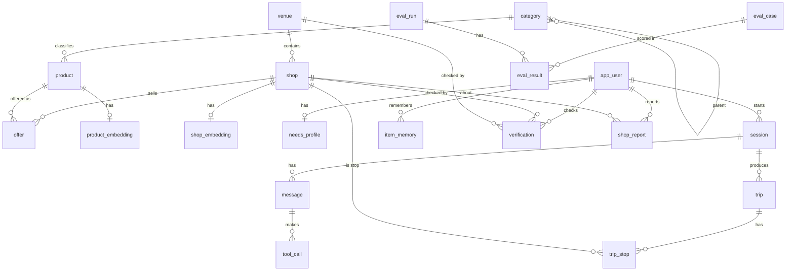
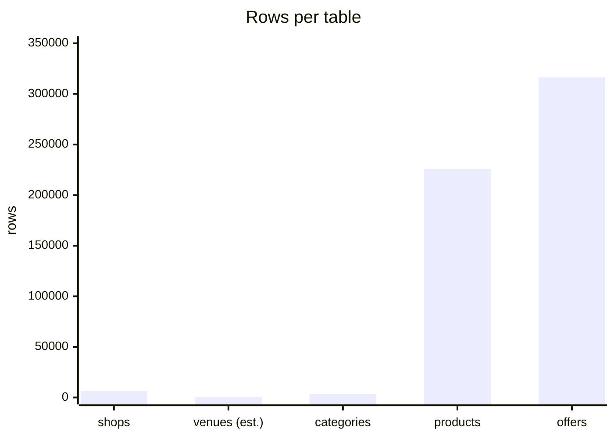
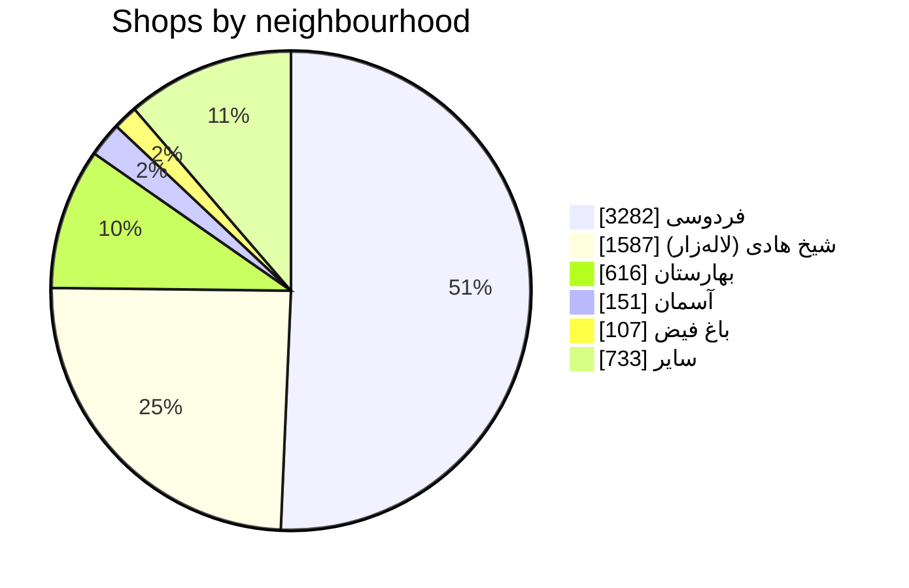

# Data model

Source of truth for the schema. PostgreSQL 16 + `pgvector` + `postgis`. Django owns migrations
(`api/`); the agent service reads the same database through SQLAlchemy Core (read-mostly) and writes
only to the `conversation` group.

IDs: dataset ids are kept verbatim as text primary keys (`shop_3f93…`, `product_4779…`,
`offer_9851…`) so every answer can cite the original record. Our own tables use `uuid`.
All timestamps `timestamptz`. Money is `bigint` toman. Persian text is stored as given; a
normalized copy (`*_norm`) is used for search (ي→ی, ك→ک, Arabic/Persian digits → ASCII, ZWNJ kept).

## Groups

```
catalog   venue, shop, category, product, offer, product_embedding, shop_embedding
people    app_user, needs_profile
conversation  session, message, tool_call, trip, trip_stop, item_memory
quality   verification, shop_report, eval_case, eval_run, eval_result
```

## Catalog

### venue — a pasazh / building / bazaar
| column | type | notes |
|---|---|---|
| id | uuid pk | |
| name | text | canonical, e.g. «پاساژ علاءالدین ۲» |
| name_norm | text unique | normalized for matching |
| aliases | text[] | «علاالدین 2», «علاءالدین2» … |
| kind | enum(pasazh, bazaar, building, street) | |
| address | text | |
| geom | geography(Point,4326) null | centroid of member shops, null until build_venues |
| floors | jsonb | `[{"floor":"-1","label":"زیرزمین"}, …]` filled by students |
| directory_photo_ids | uuid[] | media uploaded by students |
| shop_count | int | denormalized |
| verified_at | timestamptz null | last field check |

### shop (6,476 rows from `shops.csv`)
| column | type | notes |
|---|---|---|
| id | text pk | dataset `shop_id` |
| name | text | |
| name_norm | text | |
| address_raw | text | as in dataset, never edited |
| venue_id | uuid fk venue null | parsed, then verified |
| floor | text null | «6», «همکف», «-1» — text, floors are messy |
| unit | text null | «622», «پلاک 412» |
| location_hint | text null | «نبش شیخ هادی», «روبروی پله برقی» |
| parse_confidence | real | 0–1 from the address parser |
| geom | geography(Point,4326) | from lat/lon, all rows have it |
| location_label | text | dataset neighbourhood |
| category_names | text[] | from dataset |
| contacts | jsonb | `[{"channel":"phone","display_number":"…"}]` |
| instagram, website_url | text null | |
| weekly_hours | jsonb | dataset shape; `{}` = unknown |
| payment_options | text[] | |
| supports_fast_delivery | bool null | |
| offer_count | int | denormalized |
| price_band | smallint null | 1–5 computed from median offer vs category median |
| verified_at | timestamptz null | |
| verified_by | uuid fk app_user null | |

Indexes: `gist(geom)`, `btree(venue_id, floor)`, `gin(name_norm gin_trgm_ops)`, `gin(category_names)`.

### category (3,428 distinct names in products + shop category_names)
| column | type |
|---|---|
| id | serial pk |
| name | text unique |
| name_norm | text |
| parent_id | int fk null (students map a 2-level tree; null = root) |
| product_count, shop_count | int |

### product (225,903 rows)
| column | type | notes |
|---|---|---|
| id | text pk | dataset `product_id` |
| persian_title | text | |
| title_norm | text | |
| brand_name | text null | |
| category_id | int fk category | |
| model | text null | |
| image_urls | text[] | `image.torob.com` — cached locally in P3 |
| specs | jsonb | `[{"key","section","value"}]` as given |
| specs_text | text | flattened for search/embedding |
| search_tsv | tsvector | `simple` config on title_norm + brand + specs_text |
| min_price, median_price, max_price | bigint null | from offers, refreshed nightly |
| offer_count | int | distinct shops with a non-outlier offer |

Indexes: `gin(search_tsv)`, `btree(category_id)`, `btree(brand_name)`.

### offer (316,423 rows)
Loaded: 315,665 offers after dropping null price/date rows (P0).

| column | type |
|---|---|
| id | text pk |
| product_id | text fk product |
| shop_id | text fk shop |
| seller_title | text (shop's own wording for the product) |
| price_toman | bigint |
| last_price_changed_at | timestamptz |
| warranty | text null |
| description | text |
| is_outlier | bool default false (price > 10× or < 0.1× product median; set by job) |

Indexes: `btree(product_id, price_toman)`, `btree(shop_id)`, `btree(last_price_changed_at)`.

### product_embedding / shop_embedding
| column | type |
|---|---|
| product_id / shop_id | pk fk |
| model | text (e.g. `qwen/qwen3-embedding-8b`) |
| embedding | vector(4096 → stored as the model's dim) |
| text_hash | text (skip re-embedding if unchanged) |

Index: `hnsw (embedding vector_cosine_ops)`. Shop embedding text = name + categories + top 20 seller titles.

## People

### app_user
| column | type | notes |
|---|---|---|
| id | uuid pk | |
| phone_hash | text unique null | HMAC-SHA256; phone itself AES-GCM in `phone_enc`, optional |
| phone_enc | bytea null | |
| display_name | text null | |
| role | enum(shopper, student, admin) | |
| created_at, last_seen_at | timestamptz | |

Guests get an `app_user` row with no phone, keyed by a cookie.

### needs_profile — what the agent has learned about a shopper
| column | type | notes |
|---|---|---|
| user_id | uuid pk fk | |
| budget_min, budget_max | bigint null | toman |
| preferred_brands, avoided_brands | text[] | |
| categories_of_interest | int[] | |
| style_tags | text[] | from image-card interview («مینیمال», «گرم», «صنعتی») |
| constraints | jsonb | free: `{"warranty":"required","delivery":"same_day"}` |
| notes | text | agent's own summary, shown to the user, editable |
| updated_at | timestamptz | |

## Conversation

### session
| column | type |
|---|---|
| id | uuid pk |
| user_id | uuid fk |
| started_at, ended_at | timestamptz |
| context | jsonb (`{"venue_id":…, "floor":"3", "mode":"walk"}` — where the shopper says they are) |
| model | text |

### message
| column | type |
|---|---|
| id | uuid pk |
| session_id | uuid fk |
| seq | int |
| role | enum(user, assistant, system, tool) |
| content | jsonb (text + structured blocks: cards, route, price_check) |
| receipt_ids | text[] (every record id the answer was grounded in) |
| tokens_in, tokens_out, latency_ms | int |
| created_at | timestamptz |

Unique `(session_id, seq)`.

### tool_call
| column | type |
|---|---|
| id | uuid pk |
| message_id | uuid fk |
| name | text (`search_products`, `search_shops`, `price_check`, `locate_shop`, `plan_trip`, `remember`) |
| args | jsonb |
| result_summary | jsonb (ids + counts, not the full payload) |
| duration_ms | int |
| error | text null |

### trip / trip_stop — a walkable plan
| trip | | trip_stop | |
|---|---|---|---|
| id uuid pk | | id uuid pk | |
| session_id fk | | trip_id fk | |
| user_id fk | | seq int | |
| title text | | shop_id fk | |
| venue_id fk null | | reason text (why this shop) | |
| created_at | | product_ids text[] | |
| status enum(draft, active, done) | | status enum(todo, visited, skipped) | |

Stops are ordered by (venue, floor) so the shopper walks floor by floor.

### item_memory — seen / tried / bought / skipped
| column | type |
|---|---|
| id | uuid pk |
| user_id | uuid fk |
| product_id | text fk null |
| shop_id | text fk null |
| state | enum(seen, liked, tried, bought, skipped) |
| price_seen | bigint null |
| note | text null |
| created_at | timestamptz |

## Quality (the students' tables)

### verification — a field check of a shop or venue
| column | type |
|---|---|
| id | uuid pk |
| shop_id / venue_id | fk (one of) |
| checked_by | uuid fk app_user |
| checked_at | timestamptz |
| exists | bool |
| floor_ok, unit_ok, hours_ok | bool null |
| corrections | jsonb |
| photo_ids | uuid[] |

### shop_report — one-tap feedback from shoppers
`id, user_id, shop_id, kind enum(open, closed, had_item, no_item, no_answer, price_ok, price_high), product_id null, created_at`.

### eval_case / eval_run / eval_result — the agent test set
| eval_case | eval_run | eval_result |
|---|---|---|
| id, title, user_turns jsonb, expected jsonb (`{"must_cite_shop":[…], "must_mention_floor":true, "max_price":…}`), tags text[], author_id | id, started_at, model, git_sha, notes | run_id, case_id, passed bool, score real, transcript jsonb, judge_notes text |

## ERD (mermaid)




## Volume (from the dataset, 2026-10-22)





Offer prices: p10 225,000 · median 3,640,000 · p90 49,900,000 toman. 59% of shops are inside a
named pasazh; 65% have a floor in the address; 69% have opening hours; 28% have no category.

## Ingestion (P0)

1. `load_csv` → raw tables `raw_shops`, `raw_products`, `raw_offers` (as-is, for re-runs).
2. `parse_addresses` → `venue` (dedupe by `name_norm` + aliases), `shop.venue_id/floor/unit/location_hint/parse_confidence`. Rule-based regex first; LLM (Haiku) only for rows with confidence < 0.6. Students label 300 rows to measure precision (task book T-02).
3. `build_categories` → `category` with counts; students map parents (T-04).
4. `price_stats` → product min/median/max, offer outliers, shop price_band.
5. `embed` → batched BoxAPI embeddings, hash-skipped, resumable.
6. `tsv` → `product.search_tsv`.

Nightly job reruns 4–6 for changed rows. Migrations are additive (add first, remove later), same rule as fm2d.

## Retention and privacy

- Phone optional, encrypted, never logged, never in analytics. Same rule as fm2d.
- Sessions older than 90 days: messages anonymized (user_id → null), tool_calls kept for evals.
- No raw location tracking: `session.context.venue_id` is what the shopper *tells* us.
