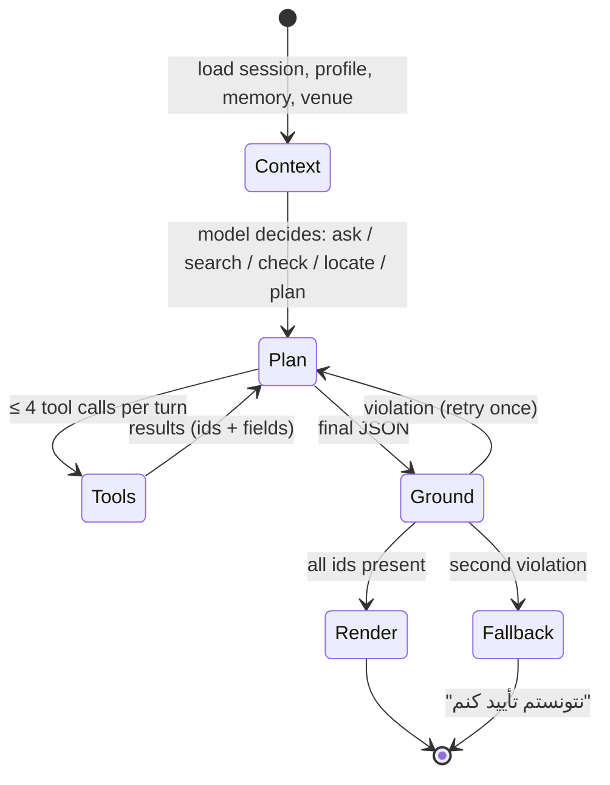

# System design

The "what and why" above the architecture. Read with `ARCHITECTURE.md` (how) and `DATA-MODEL.md`.

## 1. Problem

A shopper in downtown Tehran's electronics district (Lalezar, Ferdowsi, Baharestan) faces ~6,500
shops across ~300 pasazhs. Torob tells them online prices; nothing tells them *which pasazh, which
floor, which unit* has what they need at a fair price, or what to ask for when they don't know the
product name. The assistant closes that gap with the Starcoach dataset plus student field checks.

## 2. Users and jobs

| User | Job | Success |
|---|---|---|
| Shopper, knows the item | "Where is the cheapest 16×5 Mashhad cable near Aladdin?" | 3 shops with floor/unit and prices in one answer |
| Shopper, vague need | "Lighting for a 12 m² kitchen, modern, ~3M" | A short needs interview → 2–3 product types → shops |
| Shopper, in the shop | "Is 900k fair for this?" | Market median + cheaper nearby in < 10 s |
| Student (team) | Verify shops, write evals, map categories | Admin screens that make a field day productive |
| Mohammad | Ship the demo, judge quality | `make check`, `make eval`, cost/latency dashboard |

## 3. Requirements

Functional (v1): chat with streaming; needs interview with image cards; hybrid product search;
shop search by category/venue/geo; price check; locate shop (venue/floor/unit/hint); trip plan
ordered by floor; memory (seen/tried/bought); guest + phone OTP; admin + verification; evals.

Non-functional: Persian-first RTL; works on 2 GB Android in Bale/Eitaa webviews; p95 first token
< 2.5 s; every factual claim grounded in record ids; no foreign runtime loads except BoxAPI and
Torob images; cost < $0.02 per average conversation; one VPS.

Out of scope v1: real indoor positioning, shop self-service, payments, multi-city, voice.

## 4. Capacity (demo)

- Data: 6.5k shops, 226k products, 316k offers, 226k embeddings (~1 GB with HNSW at 1024–4096 dims; pick a ≤1024-dim model or reduce dims to keep RAM < 2 GB).
- Load: 50 concurrent sessions, ~1 turn / 20 s each → 2.5 turns/s → ~5 tool queries/s on Postgres: trivial.
- LLM: ~6k input + 600 output tokens per turn on Sonnet ≈ $0.02; Haiku for interview/classification ≈ $0.001.

## 5. The agent loop

Design choices:
- **Structured output over prose** so the UI, not the model, draws cards and routes.
- **Small tool set (6)**; new behaviour comes from prompt + data, not new tools.
- **Context budget**: last 8 turns + profile summary + venue summary; older turns summarized by Haiku.
- **Interview before search** when the request has no product noun; ask at most 2 questions per turn.

## 6. Search design

Hybrid: `tsvector` keyword (exact models, brands, sizes like «۱۶×۵») ∪ vector (intent, synonyms)
→ union top 100 → rerank (BoxAPI `cohere/rerank-v3.5` or a cheap LLM pass) → top 10.
Filters applied in SQL before ranking: category, budget, venue radius (PostGIS `ST_DWithin`).
Shops are ranked by: has offer for the product → same venue → same floor → distance → price band → verified_at.

## 7. Trust and safety

- Receipts on every answer; the UI shows "منبع: فروشگاه … ، آخرین تغییر قیمت ۲۳ شهریور".
- Prices older than 60 days are labelled «ممکن است تغییر کرده باشد».
- Outlier offers hidden from recommendations, visible on the product page.
- Prompt-injection: shop names and seller titles are data, wrapped and never executed as instructions; tool args validated.
- Privacy: phone optional and encrypted; no location history; sessions anonymized after 90 days.

## 8. Failure modes

| Failure | Behaviour |
|---|---|
| BoxAPI down / slow | after 8 s: keyword search + templated answer with cards, no prose; banner "دستیار هوشمند موقتاً در دسترس نیست" |
| No tool calling on BoxAPI | JSON-action fallback (same orchestrator) |
| Grounding fails twice | honest fallback message; logged; shows up on the quality page |
| Address parse wrong | `parse_confidence` shown as «احتمالاً» in UI; students fix in admin |
| Redis down | tools run uncached; rate limiting off (logged) |

## 9. Evaluation

- 50 eval cases by students (T-05): known-item, vague-need, in-shop price, "where exactly", adversarial (made-up pasazh).
- Hard checks + LLM judge; `make eval` prints pass rate, grounding failures, mean latency, cost.
- Release gate: pass ≥ 85%, grounding failures = 0 on known-item cases.
- Field check: 5 real shoppers walk one answer each in Aladdin (P1 demo).

## 10. Milestones

| Phase | Weeks | Gate |
|---|---|---|
| P0 Foundation | 1 | data loaded, addresses parsed (≥ 85% precision on labelled set), BoxAPI tool-calling verified, tokens + brand v1 |
| P1 Walkable demo | 2–3 | one pasazh, fixed data, real UI; 5 shoppers test |
| P2 Real agent | 4–6 | 6 tools, streaming, memory, admin, evals ≥ 85% |
| P3 Harden | 7–8 | PWA, OTP, quality dashboard, VPS, backups |
| P4 Grow | 9+ | photo-to-product, voice, shop self-service |
